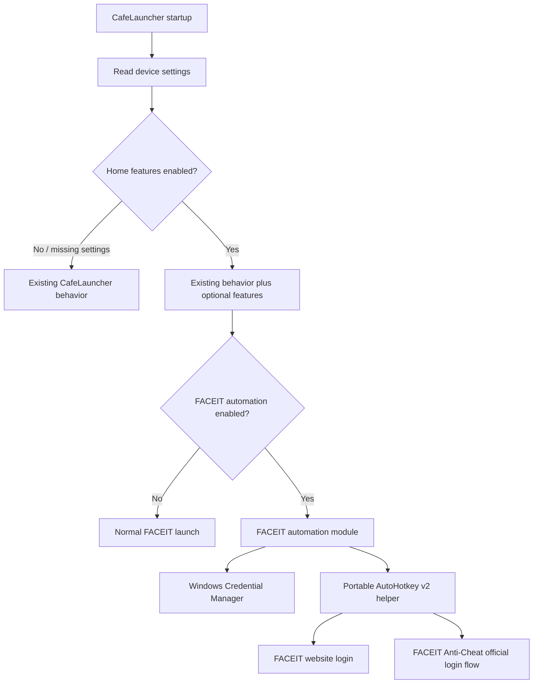

# CafeLauncher — Home PC & FACEIT Auto-Login Implementation Plan

**Status:** Planning only — no code changes  
**Purpose:** Introduce optional Home PC features using Windows Credential Manager and AutoHotkey v2, while preserving all existing internet café behavior.

## 1. Objective and design principles

Add a **Settings** tab with **Internet Café** (default) and **Home PC** environments. Internally, Home PC is an **optional feature layer**, not a separate launcher or duplicated application logic.

The initial Home PC feature is experimental FACEIT login automation for both **faceit.com** and the **FACEIT Anti-Cheat app**. For testing, use **Windows Credential Manager** for local credentials and **AutoHotkey v2** for desktop/browser interactions. Browser confirmation, CAPTCHA, Google challenges, and 2FA are deferred; automation must not bypass them.

**Non-negotiable compatibility rule:** Missing, unreadable, or invalid device settings must result in the existing Internet Café behavior. No login automation or AutoHotkey dependency handling runs in Internet Café mode.

## 2. High-level architecture



Use feature flags to isolate the optional module from profile application, graphics, DPI, and existing launch functionality.

## 3. Settings tab and UI

Add a **Settings** tab containing:

- **Device environment:** Internet Café (default) or Home PC.
- **Home PC → FACEIT Automation:** master enable switch.
- **Website auto-login:** independent checkbox.
- **Anti-Cheat auto-login:** independent checkbox.
- **Credentials:** Save, Update, Delete, and credential status (never display the stored password).
- **AutoHotkey v2 deployment:** Portable (preferred), with optional local installation only if necessary.
- **Status and troubleshooting:** show whether credentials, runtime, website session, and Anti-Cheat login are ready, without logging secrets.

Switching to Home PC should expose options without automatically enabling automation or downloading anything. Switching back to Internet Café disables the optional automation but does not silently delete credentials; provide an explicit delete action.

## 4. Local configuration

Store device-specific preferences in:

`%LocalAppData%\CafeLauncher\DeviceSettings.json`

Example **default**:

```json
{
  "Environment": "InternetCafe",
  "HomeFeatures": {
    "FaceitAutomation": {
      "Enabled": false,
      "WebsiteAutoLogin": false,
      "AntiCheatAutoLogin": false,
      "CredentialTarget": "CafeLauncher/Faceit/Home",
      "AutoHotkeyDeployment": "Portable"
    }
  }
}
```

Keep this separate from `Profiles.json`, profile CFG files, graphics configuration, and GitHub-synced data. The configuration contains preferences and credential *references*, never passwords. Validate values and fail closed to Internet Café behavior if configuration cannot be trusted.

## 5. Windows Credential Manager

Use Windows Credential Manager under the current Windows user account. Suggested credential target:

`CafeLauncher/Faceit/Home`

Requirements:

1. Save, update, retrieve, and delete FACEIT credentials using Windows credential APIs.
2. Never persist passwords in JSON, CFG, GitHub, logs, PowerShell scripts, environment files, or plaintext temporary files.
3. Never pass passwords in process command-line arguments.
4. Design a secure handoff to the automation helper; do not write credentials to disk for AutoHotkey to consume. Investigate a short-lived, access-controlled IPC mechanism or use PowerShell for the sensitive step if a safe AutoHotkey handoff is impractical.
5. Minimize how long plaintext credentials remain in memory; do not claim perfect memory erasure in managed runtimes.
6. Do not use this credential store on shared internet café machines.

Website and Anti-Cheat workflows may use the same FACEIT account where their official interfaces permit it. An already-authenticated browser session should be reused instead of typing credentials unnecessarily.

## 6. AutoHotkey v2 — portable-first

Proposed source layout:

```text
CafeLauncher/
├── cafe.bat
└── Scripts/
    └── FaceitAutomation/
        ├── FaceitLogin.ahk
        ├── FaceitAntiCheat.ahk
        └── AutomationHelper.ps1
```

Suggested local runtime location:

```text
%LocalAppData%\CafeLauncher\Tools\AutoHotkeyV2\AutoHotkey64.exe
```

**Dependency policy:**

- Internet Café: do not detect, download, install, or invoke AutoHotkey for this feature.
- Home PC with FACEIT automation disabled: no AutoHotkey dependency needed.
- Home PC with automation enabled: look for a compatible v2 runtime, then offer the official portable runtime if missing.
- Verify runtime source, version, and integrity before execution.
- Only offer conventional installation if portable execution is unavailable or unsuitable; do not silently install.
- Prefer execution without administrator privileges.
- Keep automation scripts modular and testable independently of the launcher.

## 7. FACEIT website login workflow

1. Open `https://www.faceit.com/` in Chrome using the existing launcher approach where applicable.
2. Check whether the user is already signed in.
3. If not signed in, locate the login interface.
4. Retrieve credentials securely from Windows Credential Manager.
5. Use AutoHotkey v2 to interact with the supported login UI for testing, without exposing secrets through logs, arguments, or temporary files.
6. Submit the login and verify success or report a meaningful failure; avoid assuming fixed delays prove success.
7. If Google confirmation, CAPTCHA, 2FA, or another challenge appears, stop/wait for manual completion. Handling these challenges is out of scope for the first phase.

Consider that UI coordinates, page layouts, localization, and browser focus can change; prefer robust window/control detection over hard-coded screen positions.

## 8. FACEIT Anti-Cheat login workflow

1. Start FACEIT Anti-Cheat using CafeLauncher's existing executable detection and launch logic.
2. Detect whether Anti-Cheat is already authenticated.
3. If login is required, invoke its **official authentication flow**.
4. Use AutoHotkey v2 only for supported desktop/browser UI interactions; reuse an authenticated browser session where possible.
5. Wait for and detect a successful authenticated state, or report that manual verification is required.
6. Do not inject into Anti-Cheat, tamper with protected processes, bypass security controls, or attempt to defeat authentication checks.

**Research/testing checkpoint:** Confirm the actual current FACEIT Anti-Cheat login sequence before implementing selectors, keystrokes, or state detection. Full unattended login is not guaranteed.

## 9. Existing button behavior

| Action | Internet Café | Home PC with automation enabled |
|---|---|---|
| Apply profile (FabMode, etc.) | Unchanged | Unchanged |
| Apply Graphics | Unchanged | Unchanged |
| DPI application | Unchanged | Unchanged |
| Launch Profile Apps | Existing flow | Existing flow plus optional FACEIT automation |
| Launch FACEIT Anti-Cheat | Existing flow | Existing launch plus official authentication helper |
| Edit Profile | Unchanged | Unchanged |
| Settings | Environment selection | Additional Home PC controls |

Do not trigger FACEIT login just by clicking **Apply Profile**. Keep login automation connected to the appropriate launch action or an explicitly enabled separate action. A login failure must not block unrelated launcher actions.

## 10. Error handling and security

- Default to Internet Café behavior for missing/corrupt settings.
- Require explicit Home PC and feature opt-in before accessing credentials or invoking AutoHotkey.
- If credentials are absent, show setup guidance; never attempt empty-password submission loops.
- If the portable runtime is missing, offer setup rather than crashing or changing café behavior.
- Detect already-authenticated sessions to avoid duplicate login attempts.
- Use bounded retries, timeouts, and user-visible failure states.
- Avoid plaintext credentials in process arguments, logs, crash reports, clipboard history, and temporary files. If simulated typing is used, recognize that desktop automation has security and reliability limitations.
- Do not bypass CAPTCHA, 2FA, Google verification, or FACEIT protections.
- Never sync credentials to GitHub.

## 11. Implementation phases

### Phase 1 — Settings and isolation
- [ ] Add Settings tab and environment selector.
- [ ] Create validated device-local settings file.
- [ ] Add optional feature flags and ensure default café behavior.
- [ ] Regression-test existing launch/profile/graphics/DPI actions.

### Phase 2 — Secure credentials
- [ ] Implement Credential Manager Save / Update / Delete / Read.
- [ ] Add credential status and secure failure handling.
- [ ] Confirm no secrets persist in configs or logs.

### Phase 3 — Portable AutoHotkey v2
- [ ] Detect compatible runtime only when required.
- [ ] Add verified official portable download and local cache.
- [ ] Implement helper launch and secure credential handoff.
- [ ] Add installation fallback only for Home PC if truly necessary.

### Phase 4 — FACEIT website automation
- [ ] Verify the current browser login flow.
- [ ] Detect existing login state.
- [ ] Automate supported login interactions with AHK v2.
- [ ] Pause for manual verification challenges.
- [ ] Report success/failure without breaking launcher actions.

### Phase 5 — FACEIT Anti-Cheat automation
- [ ] Verify the current official Anti-Cheat sign-in sequence.
- [ ] Reuse existing Anti-Cheat launch logic.
- [ ] Add AHK v2 interactions where appropriate.
- [ ] Detect authentication status and handle manual challenges.

### Phase 6 — Validation and rollout
- [ ] Test on a fresh install: Internet Café default.
- [ ] Test an existing café installation without migration surprises.
- [ ] Test Home PC settings persistence and credential lifecycle.
- [ ] Test portable AHK without installation or admin access.
- [ ] Test already-logged-in website and Anti-Cheat sessions.
- [ ] Test missing credentials, unavailable runtime, and failed login.
- [ ] Test switching Home PC → Internet Café → Home PC.
- [ ] Test on Deep Freeze café PCs with no credential automation.
- [ ] Verify no secrets enter source control, configs, or logs.

## 12. Future expansion

Keep Home PC conveniences as independently enabled modules. Possible later features: Windows startup integration, personal app shortcuts, automatic Steam startup, local session preferences, and device-specific automation. Do not duplicate CafeLauncher core logic.

## 13. Definition of done

The implementation is complete when the existing internet café workflow remains unchanged by default; Home PC users can explicitly enable isolated FACEIT website and Anti-Cheat login assistance; credentials remain local in Windows Credential Manager; AutoHotkey v2 runs portably where possible and is never required for café users; failures do not interrupt unrelated launch actions; and security challenges remain handled through official/manual verification.